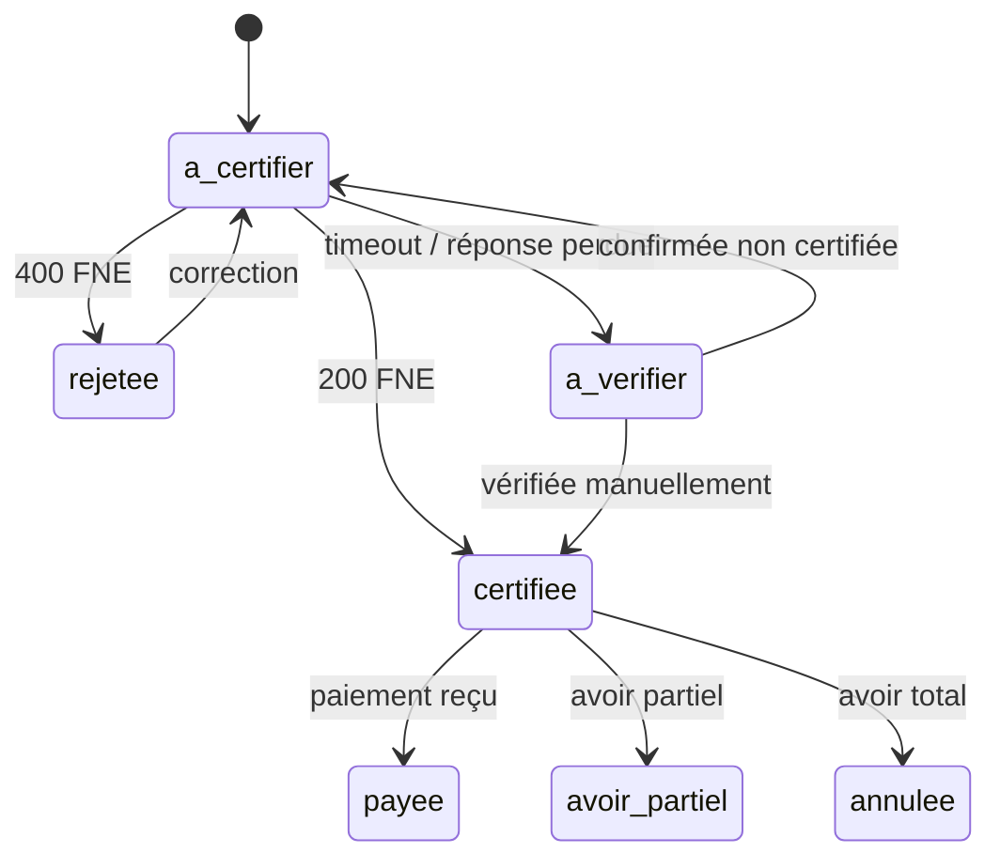

# Swipe CI — Facturation FNE mobile pour micro-entreprises

> Spécification issue du brainstorm du 24/09/2026 (session Cowork), mise à jour avec la procédure d'interfaçage API de la DGI (mai 2025). À affiner dans Claude Code avec `/plan-task` avant d'écrire du code.
> Porteur : COD ENTREPRISE SARL (Abidjan). Stack : NestJS, Angular, PostgreSQL.

## Initial User Prompt

« Je vais attaquer Swipe avec Claude Code après le brainstorm. » Swipe CI réplique en Côte d'Ivoire le modèle de [Swipe](https://getswipe.in), une startup YC de facturation mobile pour PME indiennes. On l'adapte à la **facture normalisée électronique (FNE)** de la DGI ivoirienne, obligatoire pour les micro-entreprises depuis le 1er août 2025.

### Requirements

#### Décisions validées pendant le brainstorm

| Sujet | Décision |
| --- | --- |
| Cible du MVP | Micro-entreprises au régime RMI (boutiques, artisans, prestataires) |
| Support | App mobile Android (Angular + Capacitor), publiée sur le Play Store |
| Périmètre du MVP | Facture de vente certifiée FNE, avoir FNE, catalogue produits et clients, partage WhatsApp + PDF, suivi des paiements (payé/impayé, lien de paiement, relances) |
| Hors périmètre du MVP | Mode hors ligne, iOS, bot WhatsApp, bordereau d'achat de produits agricoles, facturation en devises (B2F), tableau de bord pour cabinets comptables, branchement sur les API marchands Wave/Orange |
| Monétisation | Freemium + abonnement. Ordre de grandeur : 10 factures par mois gratuites, puis environ 2 000 à 3 000 FCFA par mois (à valider sur le terrain) |
| Prestataire de paiement | **KadevPay** (pas CinetPay), derrière une interface interchangeable |
| Approche technique | Option 1 : app Angular + Capacitor, API NestJS, PostgreSQL multi-tenant, certification FNE côté serveur |

#### Approches écartées (pour mémoire)

- **PWA seule** (proba. 0,82) : écartée, la cible attend une vraie app installable.
- **Socle partagé avec un autre produit** (0,80) : reporté. Swipe CI reste un projet autonome, sans dépendance externe.
- **Facturation par WhatsApp + LLM** (0,08), **branchement Wave/Orange marchands** (0,06), **distribution via cabinets comptables** (0,05) : leviers de croissance pour une V2.

#### Ce que dit la procédure API de la DGI (mai 2025)

**Accès et mise en production**

- **Une clé API par entreprise.** La clé est affichée dans l'onglet « Paramétrage » de l'espace FNE de l'entreprise. Elle n'est visible que par le **gestionnaire principal**, et seulement **après validation par la DGI**.
- **Procédure par entreprise :**
    1. Inscription de l'entreprise sur l'environnement de test (`http://54.247.95.108`).
    2. Développement de l'interfaçage.
    3. Tests de facture de vente, d'avoir et de bordereau.
    4. Envoi de spécimens de factures à `support.fne@dgi.gouv.ci`.
    5. Validation de la conformité par la DGI.
    6. Envoi de l'URL de production, puis affichage de la clé API.
- **Le mode API est « sur option »,** prévu pour les entreprises qui ont leur propre système informatisé de facturation. En face, la DGI propose aussi gratuitement un module web et une **application mobile** pour émettre des FNE.

**Technique**

- **API REST en JSON.** Méthode POST uniquement. Authentification `Authorization: Bearer <API KEY>`.
- **URL de test :** `http://54.247.95.108/ws` (en HTTP, pas HTTPS). L'URL de production est transmise par la DGI.

| Opération | Endpoint | Remarques |
| --- | --- | --- |
| Facture de vente | `POST {url}/external/invoices/sign` avec `invoiceType: "sale"` | Réponse 200 |
| Bordereau d'achat agricole | même endpoint avec `invoiceType: "purchase"` | Hors MVP |
| Avoir | `POST {url}/external/invoices/{id}/refund` | `id` = identifiant FNE de la facture d'origine ; corps = `items[{ id, quantity }]` avec les `id` d'articles renvoyés par la FNE. Réponse 201, référence préfixée `A` |

**Champs de la facture de vente**

- **Obligatoires :** `invoiceType`, `paymentMethod`, `template`, `isRne`, `clientCompanyName`, `clientPhone`, `clientEmail`, `pointOfSale`, `establishment`, `items[]`.
- **Obligatoires selon le cas :** `rne` si `isRne` est vrai ; `clientNcc` si `template = B2B`.
- **Facultatifs :** `clientSellerName`, `commercialMessage`, `footer`, `customTaxes`, `discount`.
- **Par article :** `description`, `quantity`, `amount` (prix unitaire HT) et `taxes[]` sont obligatoires ; `reference`, `discount` et `measurementUnit` sont facultatifs.
- **Valeurs possibles :**
    - `paymentMethod` : `cash`, `card`, `check`, `mobile-money`, `transfer`, `deferred` (à terme).
    - `template` : `B2C` (particulier), `B2B` (entreprise avec NCC), `B2G` (administration), `B2F` (international).
    - `taxes` : `TVA` (18 %), `TVAB` (9 %), `TVAC` (0 %, exonération conventionnelle), `TVAD` (0 %, exonération légale, **pour TEE et RME**).
    - Autres taxes (`customTaxes`, ex. AIRSI, DTD) : nom + taux.

**Réponse**

- `reference` : numéro fiscal, par exemple `9606123E25000000019`, soit le NCC suivi de l'année et d'un numéro séquentiel.
- `token` : URL de vérification à convertir en QR code.
- `warning` : alerte sur le **stock de stickers**.
- `balance_sticker` : nombre de stickers restants.
- `invoice` : la facture complète, avec son `id`, les `id` des articles et le détail des taxes. Il faut les conserver pour les avoirs.

**Erreurs**

- `400` : requête invalide, par exemple `"Point of sale is not valid"`.
- `401` : `"Invalid API Key"`.
- `500` : endpoint non disponible.
- Format : `{ message, error, statusCode }`.

**Ce que le document ne prévoit pas**

- Aucun endpoint de consultation (GET) ni de clé d'idempotence n'est documenté. Si l'appel expire, on ne peut pas savoir si la facture a été certifiée.

#### Conséquences pour le produit

1. **L'onboarding FNE est le vrai goulot.** Chaque commerçant doit avoir un compte FNE et obtenir sa clé API après validation DGI. Swipe CI doit l'accompagner pas à pas : inscription, spécimens, puis saisie de la clé dans l'app. Il faut vérifier si la DGI valide le logiciel une fois pour toutes, ou chaque entreprise (voir questions ouvertes).
2. **Swipe CI est en concurrence avec l'app mobile gratuite de la DGI.** La certification seule ne suffit pas à justifier un abonnement. La valeur vendue, c'est : catalogue en 3 taps, envoi WhatsApp, lien de paiement, suivi des impayés et relances, tableau de bord du CA.
3. **Micro-entreprises = TVAD par défaut.** Le profil fiscal du tenant fixe la taxe par défaut. Un RME facture en `TVAD` (0 %), ce qui simplifie les calculs du MVP.
4. **Stickers.** Chaque certification consomme un sticker. On affiche `balance_sticker` et on alerte le commerçant dès que `warning` est vrai.
5. **Impayés.** Une facture émise non payée part avec `paymentMethod: "deferred"`. Une facture payée comptant part avec `cash` ou `mobile-money`.
6. **Client comptoir.** `clientPhone` et `clientEmail` sont obligatoires, même en B2C. L'app doit prévoir une saisie rapide (téléphone du client) et une règle claire quand le client n'a pas d'e-mail. Cette règle est à confirmer avec la DGI.

#### Architecture cible

**1. App mobile (Angular + Capacitor, Android)**

- **Écrans :**
    - connexion OTP par SMS ;
    - **assistant de connexion FNE** : guide d'inscription et saisie de la clé API ;
    - tableau de bord (CA du mois, impayés, stickers restants) ;
    - nouvelle facture, liste des factures, détail de facture (avec bouton « Faire un avoir ») ;
    - catalogue, clients, abonnement ;
    - paramètres (NCC, raison sociale, point de vente, établissement, taxe par défaut, logo).
- Pas de logique fiscale côté app : elle appelle l'API.
- Cache en lecture seule (catalogue, 50 dernières factures) pour l'affichage quand le réseau est lent. Aucune création hors ligne.
- Partage natif (plugin Capacitor Share) du PDF et du lien de la facture vers WhatsApp.

**2. API NestJS — modules**

| Module | Rôle |
| --- | --- |
| `auth` | OTP SMS, JWT court + refresh token, un utilisateur appartient à un tenant |
| `tenants` | Une micro-entreprise = un tenant : NCC, régime fiscal, taxe par défaut, raison sociale, `pointOfSale`, `establishment`, logo, clé API FNE chiffrée, environnement FNE (test / prod) |
| `catalogue` | Articles (désignation, prix unitaire HT, taxe FNE, unité de mesure, référence) |
| `clients` | Clients du commerçant (nom, téléphone, e-mail, NCC si B2B, type B2C/B2B/B2G) |
| `invoices` | Machine d'états (voir plus bas), calcul des totaux, avoirs |
| `fne` | **Seul module qui parle à la DGI.** `FneGateway` : `signSale()`, `refund()`. Mapping vers le format FNE, stockage de la réponse brute, des `id` FNE (facture et articles), de la `reference`, du `token` et de `balance_sticker` |
| `pdf` | PDF de la facture certifiée avec QR code (généré depuis `token`), numéro fiscal et visuel FNE ; stockage S3 |
| `payments` | Interface `PaymentProvider` ; implémentation `KadevPayProvider` ; lien de paiement par facture ; webhook → facture « payée » |
| `billing` | Abonnement Swipe du commerçant (plans, quotas, facturation via KadevPay, webhook → activation du plan) |
| `reminders` | Relances d'impayés (lien WhatsApp pré-rempli dans le MVP) |
| `jobs` | BullMQ + Redis : certification FNE, génération PDF, relances |

**3. Données (PostgreSQL)**

- Multi-tenant par colonne `tenant_id` + Row Level Security.
- Tables principales : `tenants`, `users`, `products`, `customers`, `invoices`, `invoice_lines`, `fne_certifications` (réponse brute, `fne_invoice_id`, `reference`, `token`, `balance_sticker`), `fne_invoice_items` (lien ligne locale ↔ `id` article FNE), `credit_notes`, `payment_links`, `payments`, `subscriptions`, `usage_counters`, `audit_logs`.
- Montants en entiers (FCFA). Les totaux affichés après certification viennent de la réponse FNE (`amount`, `vatAmount`), pas d'un recalcul local.
- Clé API FNE chiffrée au repos (clé de chiffrement hors base). Elle n'est jamais renvoyée à l'app.
- Une facture certifiée ne se modifie jamais : toute correction passe par un avoir FNE, puis une nouvelle facture.

#### Flux principaux

**Connecter le commerçant à la FNE**

1. L'assistant explique les étapes DGI et renvoie vers l'inscription.
2. Le commerçant saisit sa clé API et choisit l'environnement (test pendant la validation, prod ensuite). La clé est chiffrée côté serveur.
3. L'API fait une certification de test en environnement de test pour vérifier la clé, puis propose d'exporter les spécimens à envoyer à `support.fne@dgi.gouv.ci`.

**Créer et certifier une facture**

1. Le commerçant choisit le client et les articles, indique si la facture est payée (cash / mobile money) ou à terme (`deferred`), puis valide. L'API crée la facture au statut `à_certifier` et vérifie le quota du plan.
2. Le job `fne.certify` appelle `POST /external/invoices/sign`.
3. En cas de 200 : `reference`, `token`, `id` FNE et `id` des articles sont enregistrés, statut `certifiée`, puis job `pdf.generate`. Si `warning` est vrai, alerte « stickers bientôt épuisés ».
4. L'app reçoit la mise à jour (polling court ou notification push) et propose « Partager sur WhatsApp ».

**Faire un avoir**

1. Depuis une facture certifiée, le commerçant choisit les articles et les quantités à reprendre.
2. `POST /external/invoices/{id FNE}/refund` avec les `id` d'articles FNE enregistrés. En cas de 201, on enregistre la référence de l'avoir (préfixe `A`) et son `token`, puis on génère le PDF.

**Encaisser une facture**

1. Pour une facture certifiée à terme, l'API crée un lien de paiement via `PaymentProvider` (KadevPay).
2. Le lien est inclus dans le message WhatsApp.
3. Le webhook KadevPay (signature vérifiée, traitement idempotent) enregistre le paiement et passe la facture en `payée`. Le commerçant peut aussi marquer « payée en espèces ».

**Payer l'abonnement Swipe**

1. Quand le quota gratuit est atteint, l'app propose un plan.
2. Paiement via KadevPay, le webhook active ou prolonge le plan dans `subscriptions`.

#### Machine d'états d'une facture

#### Gestion des erreurs

- **Pas d'idempotence côté FNE : risque de double certification.** On ne réessaie automatiquement **que** si l'échec est certain avant envoi (connexion refusée, DNS) ou en cas de `500 Endpoint non disponible`. En cas de timeout après envoi, la facture passe en `à_vérifier` : l'admin ou le commerçant vérifie dans l'espace FNE avant tout renvoi. Aucun renvoi automatique dans ce cas.
- **400 (données invalides)** : statut `rejetée`, `message` FNE traduit en français simple (ex. « Point de vente non valide » → lien vers les paramètres), facture corrigeable puis renvoyée.
- **401 (clé invalide)** : blocage des certifications du tenant, notification « Reconnectez votre compte FNE ».
- **Stickers épuisés** : message clair et lien vers la procédure DGI de rechargement (à documenter).
- **Webhook KadevPay** : vérification de signature, rejeu toléré, réconciliation quotidienne avec l'API KadevPay.
- **Quota Swipe dépassé** : blocage de la certification uniquement ; consultation et partage restent possibles.
- **Journal d'audit** de toutes les actions fiscales (création, certification, avoir, vérification manuelle).

#### Tests

- **Unitaires** : mapping vers le format FNE (champs obligatoires, B2B ⇒ `clientNcc`, taxe par défaut `TVAD` pour RME), machine d'états, quotas.
- **Contrat FNE** : `FneGateway` testé contre un faux serveur reproduisant les exemples du PDF (200 vente, 201 avoir, 400, 401, 500, timeout), puis contre l'environnement de test DGI `http://54.247.95.108/ws`.
- **Avoirs** : les `id` d'articles FNE sont bien conservés et renvoyés.
- **Paiements** : `KadevPayProvider` testé avec webhooks simulés (signature valide/invalide, doublons).
- **Intégration** : isolation multi-tenant (tests RLS), clé API jamais exposée par l'API publique.
- **E2E mobile** : parcours « connecter la FNE → créer → certifier → partager → marquer payée → avoir » sur émulateur Android.

#### Questions ouvertes (à trancher avant ou pendant `/plan-task`)

1. **Validation DGI :** la DGI valide-t-elle chaque entreprise ou le logiciel une fois pour toutes ? Un éditeur peut-il faire valider Swipe CI une seule fois, pour que ses clients activent ensuite leur clé plus vite ? À demander à `support.fne@dgi.gouv.ci`.
2. **Micro-entreprises et API :** un RME peut-il opter pour le mode API alors que la procédure vise les entreprises « disposant de leur propre système informatisé » ? À confirmer avec la DGI.
3. **Stickers :** comment sont-ils obtenus et rechargés (achat, dotation) et à quel coût pour le commerçant ?
4. **Vérification d'une facture après timeout :** existe-t-il un endpoint de consultation non documenté ? Sinon, comment vérifier dans l'espace FNE ?
5. **Client comptoir :** quelles valeurs accepter pour `clientPhone` et `clientEmail` quand le client est un particulier anonyme ?
6. **Remises :** `discount` est-il un pourcentage ? Les exemples le suggèrent, à vérifier en environnement de test.
7. **Architecture :** présentée mais pas encore validée explicitement.
8. **KadevPay :** documentation de l'API (liens de paiement, webhooks, signature), frais, moyens de paiement couverts (Wave, Orange Money, MTN, Moov).
9. **Prix de l'abonnement** et nombre de factures gratuites : à tester avec 20 micro-entreprises, face à l'app gratuite de la DGI.
10. **OTP SMS :** prestataire (ex. Orange SMS API) et coût.

#### Critères de succès du MVP

- Un commerçant déjà muni de sa clé API FNE crée et certifie sa première facture en moins de 2 minutes.
- 20 micro-entreprises abonnées payantes à Abidjan.
- Taux de certification FNE réussie supérieur à 98 % (hors indisponibilité DGI), et zéro double certification.

## Description

_À remplir à l'étape `/plan-task`._
